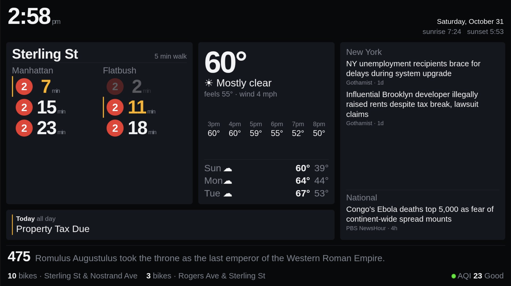

# Sterling St wall display

A Raspberry Pi dashboard for a wall-mounted HDMI panel. Python does all the
work; Chromium is only a picture frame.

Built for Sterling St on the IRT Nostrand Ave line in Brooklyn, but the station,
location and feeds are all configuration — see [Adapting it](#adapting-it-to-your-stop).

<!-- Add a photo of yours on the wall. Nothing sells this like the real thing:
      -->



- Live subway departures both directions, with a walk-time rule so trains you
  can't physically make are dimmed instead of taunting you
- Current conditions, the next six hours, a four-day forecast, NWS severe alerts
- Apple Calendar via iCloud CalDAV
- Local and national headlines from public RSS, cycling every 45 seconds
- An "on this day" fact that changes every seven minutes
- Nearest Citi Bike docks and air quality along the bottom

Every data source is **keyless** except the calendar, which needs an Apple
app-specific password.

## Hardware

- Raspberry Pi 4 or 5, running Raspberry Pi OS **Desktop** (Bookworm or later).
  The Lite image has no browser or graphical session, so the kiosk has nothing
  to attach to.
- Any HDMI panel. Sizing adapts to the aspect ratio.
- A Pi 3 works but Chromium takes 30+ seconds to paint the first frame.

## Why this shape

Flask renders the whole board server-side and the page swaps in a freshly
rendered fragment every 15 seconds. The browser runs four lines of JavaScript
and holds no logic, so every formatting decision lives in Python where you can
test it. Each data source polls on its own background thread at its own
interval, so a slow API never blocks a page load, and a dead API dims one panel
rather than taking down the board.

## Setup

On the Pi, with **Desktop Autologin** enabled (`sudo raspi-config` → System
Options → Boot / Auto Login):

```bash
sudo apt install -y git python3-venv chromium-browser fonts-liberation2 curl
git clone https://github.com/YOUR-USERNAME/pi-dashboard.git ~/pi-dashboard
cd ~/pi-dashboard
bash install.sh
```

Then add your iCloud credentials to `.env` and your own settings to
`local_settings.py` — `install.sh` creates both on first run — and
`systemctl --user restart dashboard`.

Updating later is `git pull && bash install.sh`. Your `.env` and
`local_settings.py` are gitignored, so they survive every update.

`install.sh` is also the update path -- it is safe to run repeatedly. It builds
the venv, installs the services, waits for the page to actually render, and
prints the reason if it does not.

## Your settings go in local_settings.py

`config.py` ships with every update and gets overwritten. Anything you tune
belongs in `local_settings.py`, which is never part of a release, so your
values survive upgrades:

```python
HOST = "0.0.0.0"
WALK_MINUTES = 5
```

Any name from `config.py` can be overridden there. `install.sh` creates the
file from `local_settings.example.py` on first run.

### Apple Calendar

iCloud CalDAV needs an **app-specific password** — your Apple ID password will
be rejected. Generate one at appleid.apple.com → Sign-In and Security →
App-Specific Passwords, and put it in `.env` along with your Apple ID.

If you'd rather not put credentials on the Pi, share the calendar from the
Calendar app (Edit → Public Calendar), copy the `webcal://` link, and set
`ICS_URL` instead. That path is read-only and lags a few minutes, and it only
sees calendars you explicitly publish.

### Subway

No API key. The MTA dropped that requirement — the GTFS-Realtime feeds are now
just public protobuf over HTTPS. Sterling St is stop `242` on the IRT Nostrand
Ave line; `242N` is Manhattan-bound, `242S` runs toward Flatbush Av–Brooklyn
College. The 2 and 5 both ride the numbered-lines feed.

For any other station:

```bash
.venv/bin/python -m dashboard.sources.subway --find "Winthrop"
```

`WALK_MINUTES` is the one number worth tuning, and it belongs in
`local_settings.py`. It decides which trains render as reachable, so measure
your real door-to-platform time once and set it honestly — the whole point of
the amber marker is that you trust it.

### Adapting it to your stop

Four settings in `local_settings.py` move the board to a different station:
`SUBWAY_STOP`, `SUBWAY_DIRECTIONS` (the platform IDs and what to call them),
`SUBWAY_FEED` (which numbered/lettered feed your line rides), and
`LATITUDE`/`LONGITUDE`. Use `--find` above to get the stop ID. Weather and air
quality work anywhere; Citi Bike is GBFS, so any bikeshare city works by
swapping the feed URL in `extras.py`.

### News

Headlines come from public RSS feeds listed in `config.py`, tagged `nyc` or
`national`. Only the headline and the outlet are shown, never article text.

Feeds move and die, so validate before trusting a change:

```bash
.venv/bin/python -m dashboard.sources.news --check
```

Of the shipped defaults, Gothamist's feed is verified current; the rest are
worth running the checker against on first boot. Swap in whatever you actually
read -- most outlets still publish RSS at `/feed` or `/rss`.

When a story runs both locally and on a national wire, the local section claims
it, so a big city story doesn't get filed under National and disappear from
New York.

### Rotation

Both new panels cycle without storing anything. The server derives the current
slice from wall time — `int(time.time() // interval)` — so every render agrees,
nothing drifts, and two browsers pointed at the board stay in step. The news
window wraps around its pool, so all twelve headlines per section get airtime
even though only three are visible. Tune `NEWS_ROTATE_SECONDS` and
`FACT_ROTATE_SECONDS` in `config.py`.

"On this day" comes from Wikipedia's curated feed and is cached by date, so it
costs one request a day no matter how often the poller wakes up. Facts that
mention New York get the amber marker.

### Run it on boot

```bash
mkdir -p ~/.config/systemd/user
cp deploy/dashboard.service deploy/kiosk.service ~/.config/systemd/user/
systemctl --user daemon-reload
systemctl --user enable --now dashboard kiosk
sudo loginctl enable-linger $USER
```

`deploy/screen-schedule.cron` blanks the panel overnight. Those commands are
X11. Pi OS Bookworm defaults to Wayland on Pi 4 and 5, where the equivalents
are `wlopm --off '*'` and `wlopm --on '*'`. Check with `echo $XDG_SESSION_TYPE`.

If the panel is mounted portrait, rotate in `/boot/firmware/cmdline.txt`
(`video=HDMI-A-1:1280x800@60,rotate=90`) rather than in CSS — the browser will
lay out against the real viewport and you avoid fighting the grid.

## Checking on it

`http://<pi>:8080/healthz` reports every source and its last error. Any source
that's failing also prints along the bottom of the board itself, so you can see
from across the room that the calendar has quietly stopped authenticating.

## Adding a panel

1. Write `fetch()` in `dashboard/sources/yourthing.py` returning a plain dict.
2. Register it in `SOURCES` in `poller.py` and give it an interval in
   `REFRESH_SECONDS`.
3. Render `{{ yourthing }}` in `templates/panel.html` and add it to `_context()`.

Keep `fetch()` free of formatting concerns beyond what the template needs, and
let it raise on failure — the poller catches, keeps the last good value, and
backs off.

## Sizing for your panel

Every size on the board is in `rem`, and the root size is derived from viewport
**height**:

```css
font-size: calc(min(2.02vh, 1.6vw) * var(--scale));
```

Setting the root from height makes the board land flush against the bottom on
any screen shape. Deriving it from width instead — the obvious first instinct —
leaves a dead band at the bottom of anything proportionally taller than you
assumed. The `vw` term is only a guard so a narrow window doesn't overflow
sideways.

The divisor allows for the **agenda row**, which appears only when your
calendar has events. Size for the empty-calendar case and the columns overflow
the moment an event shows up — the weather forecast is the first thing to clip.
`FORECAST_DAYS` is set to three for the same reason: four only fits when the
agenda row is absent.

If it reads small from where you actually stand, there is one knob — `--scale`
at the top of `dashboard/templates/index.html`:

```css
--scale: 1.15;     /* everything 15% larger */
```

Reload the page to see the change; no restart needed, since the template is
read per request. Raise it until something clips, then back off a notch. Prefer
this over editing individual sizes, which will drift out of proportion.

`SUBWAY_COUNT` and `NEWS_SHOWN` trade rows for size, which is the real lever:
fewer rows means each one gets more height. Change these rather than editing
individual font sizes, which drifts the proportions. The two directions render
side by side, which halves the rows the card must be tall enough for, so
`SUBWAY_COUNT` can be generous — five per direction fits comfortably.

`NEWS_SHOWN` is per section:

```python
NEWS_SHOWN = {"nyc": 2, "national": 1}
```

Three total is the ceiling, and it is arithmetic rather than taste. Headlines
wrap rather than truncate, a long one runs three lines, and four three-line
headlines overflow the column. If you want four, the headline size has to come
down to roughly 1.1rem — legible up close, not from across the room. The cards
are `overflow: hidden`, so going over clips the last story rather than breaking
the layout.

## Troubleshooting

| Symptom | Check |
|---|---|
| Blank screen, services running | `wlopm` — the overnight cron may have it off |
| Kiosk won't start (`203/EXEC`) | Handled: the unit invokes bash directly, so the executable bit can't matter |
| A panel is dark | `curl -s localhost:8080/healthz` names the failing source and its error |
| Everything is dark | `journalctl --user -u dashboard -n 40` |
| Headlines a day old | `python -m dashboard.sources.news --check` — a feed has probably died |
| Occasional `offline: weather` | A transient API timeout. The poller backs off and recovers on its own |

Each source also runs standalone for isolated debugging:

```bash
.venv/bin/python -m dashboard.sources.weather
.venv/bin/python -m dashboard.sources.subway
```

For the calendar check, load the environment first — nothing sources `.env`
automatically in a shell:

```bash
set -a && source .env && set +a
.venv/bin/python -m dashboard.sources.calendar_source
```

## Data sources

All keyless except iCloud. If you fork this, keep the attributions — a couple
of these ask for them.

| Panel | Source | Notes |
|---|---|---|
| Subway | [MTA GTFS-Realtime](https://api.mta.info/) | No API key required |
| Weather | [Open-Meteo](https://open-meteo.com/) | Free for non-commercial use |
| Alerts | [NWS API](https://www.weather.gov/documentation/services-web-api) | Asks that you identify yourself in `USER_AGENT` |
| Calendar | iCloud CalDAV | App-specific password |
| News | Publisher RSS | Headlines and outlet only, never article text |
| On this day | [Wikipedia REST API](https://en.wikipedia.org/api/rest_v1/) | Content is CC BY-SA |
| Citi Bike | [GBFS](https://gbfs.org/) | Open standard — works in any GBFS city |
| Air quality | Open-Meteo Air Quality | US AQI |

Set `USER_AGENT` in `.env` to something with a real contact address. The NWS
asks for it and has been known to block requests without one.

## Design notes

The visual language is lifted from the platform: black ground, Helvetica,
route bullets in the MTA's real spec colours, and the amber of the countdown
clocks over the Nostrand Ave platforms. Liberation Sans is installed as the
Helvetica stand-in because Pi OS ships neither Helvetica nor Arial.

One idea carries the board: an amber bar marks the first train you can actually
catch. Everything above it is dimmed. Everything else on screen stays quiet.

## License

MIT — see [LICENSE](LICENSE). The code is mine to give away; the data belongs to
the sources above and carries their own terms.
